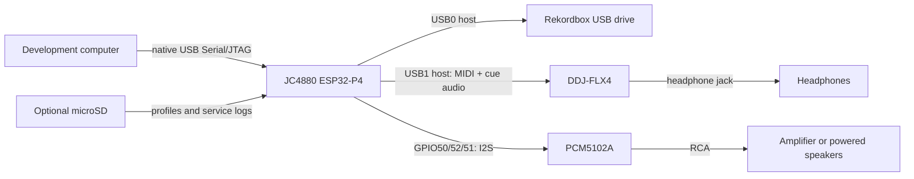
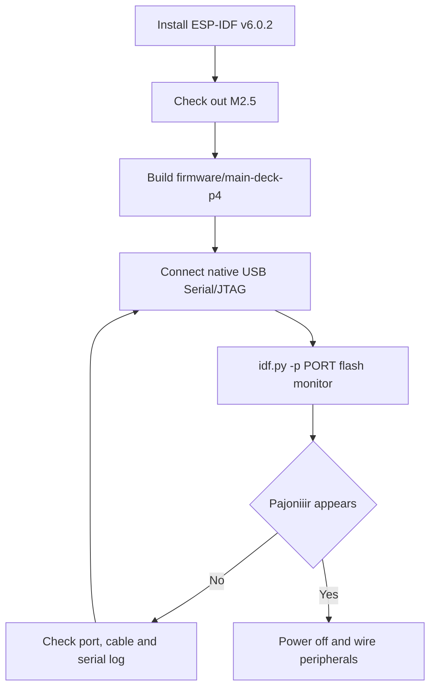
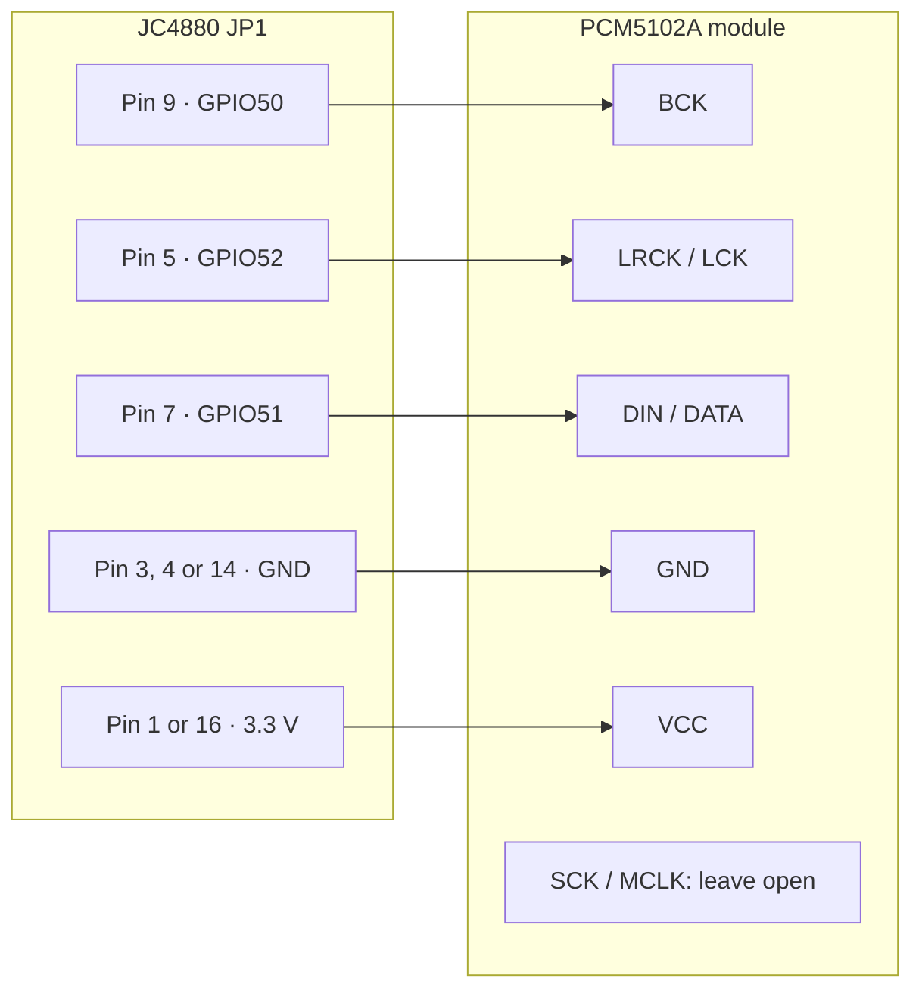
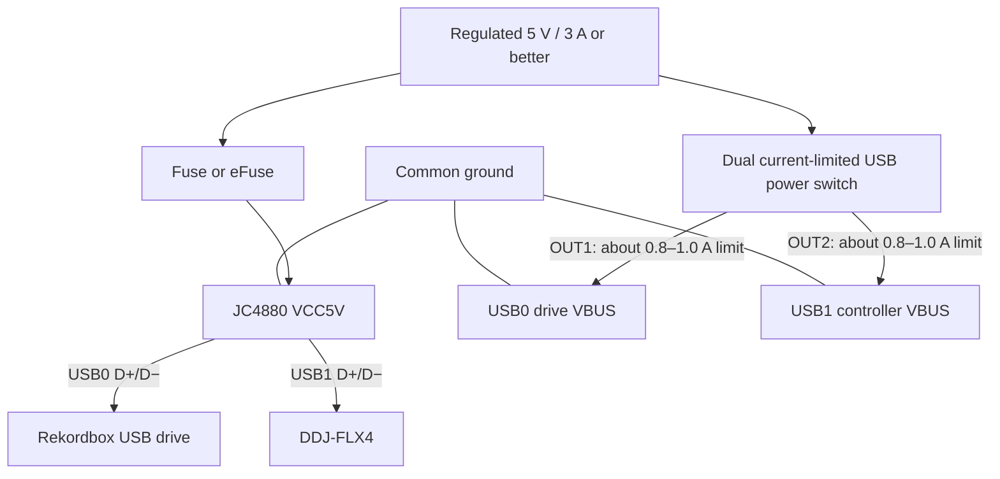

# Getting started: JC4880

This guide takes a blank Guition `JC4880P443C_I_W` from first wired flash to a
working Pajoniiir system with a DDJ-FLX4, Rekordbox USB drive and PCM5102A MAIN
output. It applies only to the JC4880. Do not use these GPIO assignments on the
JC1060 or M3 boards.

## What you need

- JC4880P443C_I_W board with its display connected
- data-capable USB cable for the ESP32-P4 native USB Serial/JTAG port
- computer with Git, Python and ESP-IDF **v6.0.2**
- PCM5102A stereo DAC module
- DDJ-FLX4 and its USB cable
- Rekordbox-formatted USB drive
- regulated 5 V / 3 A or better system supply
- two independently current-limited downstream USB power outputs
- hookup wire and a multimeter
- optional FAT32 microSD card for service logs and additional controller profiles

The FLX4 mapping is built into the firmware. A controller profile on microSD is
not required for the FLX4.



## 1. Inspect the board before applying power

1. Disconnect the controller, USB drive, DAC and external 5 V supply.
2. Inspect for solder bridges, damaged connectors and loose display cables.
3. With a multimeter, verify that 5 V is not shorted to ground.
4. Identify the native USB Serial/JTAG connector used for flashing. Do not
   assume that a power-only USB cable carries data.

> [!CAUTION]
> Do not join independent 5 V supplies, inject power through a passive Y-cable,
> or backfeed either USB host port. During first flash, power the bare board only
> through the intended service connection. Add the external system supply and
> downstream USB power distribution only after flashing succeeds.

## 2. Install the exact ESP-IDF version

Pajoniiir currently requires ESP-IDF **v6.0.2**. Follow Espressif's
[ESP-IDF installation guide](https://docs.espressif.com/projects/esp-idf/en/v6.0.2/esp32p4/get-started/index.html)
for your operating system. Install support for the ESP32-P4.

Open an ESP-IDF-enabled terminal and verify the version:

```text
idf.py --version
```

The output must report `ESP-IDF v6.0.2`. Do not continue with a different IDF
version: dependencies, USB behavior and generated flash images are version
sensitive.

## 3. Get the firmware

For the stable JC4880/DDJ-FLX4 system, check out the `M2.5` release:

```bash
git clone --branch M2.5 --depth 1 https://github.com/dvucinozd/Pajoniiir.git
cd Pajoniiir/firmware/main-deck-p4
```

The downloadable `main-deck-p4.bin` and `.ddjota` files are application-only
artifacts. They are not sufficient for a blank board because a first
installation also needs the bootloader, 16 MB partition table and OTA metadata.
Building and using `idf.py flash` installs the complete set at the offsets
generated by ESP-IDF.

## 4. Build the JC4880 firmware

From `firmware/main-deck-p4`:

```bash
idf.py build
```

The project selects `esp32p4`, the JC4880 board provider and the 16 MB flash
layout through its checked-in defaults. A successful build produces the
bootloader, partition table, OTA initialization data and application image in
the local `build` directory.

If this directory was previously used for another board or experiment, remove
the stale configuration first:

```bash
idf.py fullclean
idf.py build
```

Never reuse a JC1060 or M3 build directory for the JC4880.

## 5. Find the serial port

Connect only the JC4880 service USB cable.

On macOS:

```bash
ls /dev/cu.usbmodem*
```

On Linux:

```bash
ls /dev/ttyACM*
```

On Windows, look under **Ports (COM & LPT)** in Device Manager for the ESP32-P4
USB Serial/JTAG device.

Use the newly appearing port in the next step. If no port appears, first replace
the cable with a known data cable. If automatic download mode fails, use the
board vendor's BOOT/RESET procedure: hold BOOT, tap RESET, then release BOOT.

## 6. Perform the first wired flash

From `firmware/main-deck-p4`, replace `<PORT>` with the detected device:

```bash
idf.py -p <PORT> flash monitor
```

Examples:

```bash
# macOS
idf.py -p /dev/cu.usbmodem101 flash monitor

# Windows PowerShell
idf.py -p COM15 flash monitor
```

For a reused board where erasing all prior settings and applications is
intentional:

```bash
idf.py -p <PORT> erase-flash
idf.py -p <PORT> flash monitor
```

`erase-flash` permanently removes existing applications, Wi-Fi settings,
controller state and diagnostics. It is not needed for a genuinely blank board.

After flashing, reset the board if it does not restart automatically. The
display should initialize and show Pajoniiir. Exit the serial monitor with
`Ctrl+]`.



## 7. Wire the PCM5102A

Power the system off before changing any connection. On JC4880 header JP1, wire:

| PCM5102A pin | JC4880 connection | JP1 pin | Purpose |
| --- | --- | --- | --- |
| `BCK` | GPIO50 | 9 | I2S bit clock |
| `LRCK` or `LCK` | GPIO52 | 5 | I2S word-select clock |
| `DIN` or `DATA` | GPIO51 | 7 | Audio data from the ESP32-P4 |
| `GND` | GND | 3, 4 or 14 | Common signal and power ground |
| `VCC` | 3.3 V initially | 1 or 16 | DAC module power |
| `SCK` or `MCLK` | not connected | — | Firmware does not generate PCM5102A MCLK |

Some PCM5102A modules label their input `DATA`; this is the same connection as
`DIN`. GPIO51 is the ESP32-P4's `DOUT`, so it connects to the DAC's input.



Start at 3.3 V unless the documentation for your exact breakout explicitly
requires 5 V. Breakout boards differ in their onboard regulator and pin
strapping. Never feed 5 V into an ESP32-P4 GPIO.

The GPIO10/12/13 signals found elsewhere in the BSP belong to the legacy
onboard ES8311 path; they are not the external PCM5102A MAIN output.

## 8. Wire power and USB peripherals

The P4 data connections and downstream device power must share ground, but each
USB device needs a protected VBUS output. Do not assume that feeding JP1 `VCC5V`
automatically provides safe downstream USB power.



1. Connect the Rekordbox drive to **USB0**.
2. Connect the DDJ-FLX4 to **USB1**.
3. Connect the PCM5102A RCA output to an amplifier or powered speakers with
   their volume initially low.
4. Connect headphones to the FLX4 for cue monitoring.
5. Verify continuity, polarity, common ground and the absence of VBUS backfeed
   before applying power.

For final installation, complete the voltage-drop, current-limit and reconnect
checks in [Hardware Wiring](HARDWARE_WIRING.md). The abbreviated diagram above
is not a substitute for electrical acceptance.

## 9. Prepare the optional microSD card

The firmware can boot and use the built-in FLX4 map without a microSD card. A
FAT32 microSD card is recommended because the firmware uses it for service logs
and data-driven controller profiles.

For extra controller profiles, create this structure:

```text
/controllers/
    controller_profile_id/
        profile.s3bin
```

The P4 does not load `profile.json`. Compile it on a computer and install the
resulting `profile.s3bin`; see
[Controller Profile Update Procedure](CONTROLLER_PROFILE_UPDATE.md).

## 10. First complete startup

1. Keep the amplifier or powered speakers at low volume.
2. Insert the optional microSD card.
3. Insert the Rekordbox USB drive into USB0.
4. Connect the FLX4 to USB1.
5. Apply the regulated system power.
6. Wait for the Library screen and controller connection.
7. Browse to a track and load it onto Deck 1.
8. Raise Deck 1 trim and channel fader, place the crossfader appropriately, and
   raise the master level gradually.
9. Press Play and confirm audio from the PCM5102A RCA output.
10. Enable Deck 1 PFL and confirm cue audio through the FLX4 headphones.

If Wi-Fi Remote is enabled, join:

```text
SSID:     Pajoniiir
Password: Pajoniiir
Address:  http://192.168.4.1/
```

## 11. Verify each subsystem separately

Use this order so one fault does not hide another:

1. **Display and touch:** the interface appears and responds.
2. **USB storage:** the Library lists tracks from USB0.
3. **Controller MIDI:** Play/Cue and faders update the screen.
4. **PCM5102A clocking:** while audio is active, check:
   - LRCK is approximately 44.1 kHz or 48 kHz;
   - BCK is approximately 1.4112 MHz at 44.1 kHz or 1.536 MHz at 48 kHz;
   - DATA shows activity.
5. **MAIN audio:** RCA output is audible and clean.
6. **Cue audio:** PFL is audible from the FLX4 headphone output.
7. **Reconnect:** with both decks stopped, reconnect each USB device and verify
   recovery.

## Troubleshooting

### The board does not appear as a serial port

- use a known data-capable USB cable;
- disconnect external peripherals and external power;
- try another host USB port;
- use BOOT/RESET to enter download mode;
- verify that the selected port disappears when the board is unplugged.

### Flash succeeds but the display remains blank

- confirm that you built `firmware/main-deck-p4`, not the JC1060 or M3 target;
- confirm ESP-IDF v6.0.2;
- inspect the serial monitor for reset loops or display initialization errors;
- reseat the display cable only while power is off.

### The FLX4 does not control the UI

- verify it is connected to JC4880 **USB1**;
- verify that USB1 has protected 5 V VBUS and common ground;
- no SD controller profile is needed for the exact FLX4 VID/PID;
- stop both decks before unplugging or reconnecting the controller.

### There is no PCM5102A audio

- verify the signal mapping—not merely the three GPIO numbers:
  GPIO50→BCK, GPIO52→LRCK and GPIO51→DIN;
- verify DAC power and common ground;
- leave SCK/MCLK unconnected;
- check channel fader, crossfader, trim and master level;
- probe LRCK and BCK before investigating analog RCA circuitry;
- check the exact module's mute/XSMT strapping.

### The system resets when a USB device is connected

Treat this as a power-distribution fault first. Check voltage at the board and
both device connectors during insertion, current limiting and VBUS isolation.
A basic multimeter may miss a short transient; use min/max capture or an
oscilloscope for final qualification.

## Updating after first installation

Once a complete wired image is installed, use the signed
`main-deck-p4.ddjota` package for ordinary updates. Do not upload a raw `.bin`
to the signed OTA endpoint. See [OTA Update Procedure](OTA-UPDATE.md).

Use a complete wired flash again if the bootloader or partition table changes,
neither OTA slot boots, or the board trust key must change.

## Sources of truth

- [JC4880 pin inventory](../firmware/main-deck-p4/PINOUT_P4.md)
- [Hardware wiring and electrical acceptance](HARDWARE_WIRING.md)
- [Controller profile schema](CONTROLLER_PROFILE_SCHEMA.md)
- [Controller profile update procedure](CONTROLLER_PROFILE_UPDATE.md)
- [OTA update procedure](OTA-UPDATE.md)
- [Normal startup checklist](STARTUP_CHECKLIST.md)
