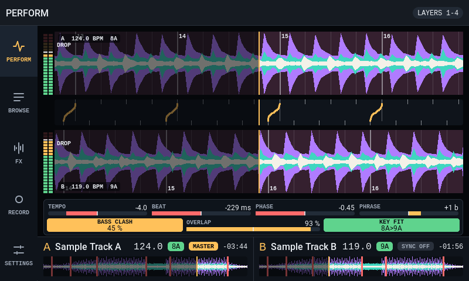
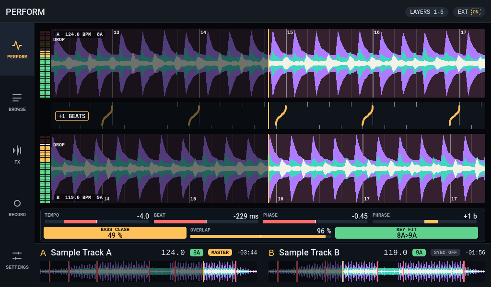

# Shared-core branch integration, 2026-10-19

The qualified shared-core branch is merged into `master` through
[PR51](https://github.com/dvucinozd/Pajoniiir/pull/51), merge
`d878c0665515a94c0312e37a2476f13944f4a4fd`. Its tree equals the reviewed
`cb90e2e6` head exactly. The follow-up integration imports the new UI as a
disabled development prototype and repairs/adapts the Numark DJ2GO2 Touch
profile. No JC8012 driver, old JC1060 implementation or APTA duplicate is merged.

This follows the [remaining-branches review](2026-10-19-remaining-branches-merge-review.md).
The tested implementation is clean commit
`abffb203bfc4807b9ef622f520b02a9335afc415`; later changes in this delivery are
documentation and evidence only. New-image physical acceptance, signing and
installation are **NOT RUN**. Existing installed firmware and immutable beta2
assets remain unchanged.

## Integration boundaries

| Source | Decision and implementation |
| --- | --- |
| Shared core `cb90e2e6` | PR51 merges the qualified fixes and their existing board-specific acceptance records first. |
| New UI `b8dccf26` | Imported with merge `7975bb02`; explicitly disabled, no ESP-IDF component CMake/startup selection. Demo data and touch/core gaps remain documented. Original font licences and contributor history are retained. Generated font EOF whitespace is normalized without changing glyph data. |
| Numark `86d6b412` | Imported/adapted in `47b322fd`; new absolute PFL semantics, installed tests and updated binary. `3ea1a088` removes the superseded patch attachment from the active tree while retaining it in donor Git history. `abffb203` completes absolute-level disconnect cleanup. |
| JC1060 `00041a0d` | Already selectively adapted in `c0ee8152`; no whole-donor merge or reintroduction of its root-admission shortcut. |
| JC8012 `694ecd6a` | Not merged. Touch-driver provenance and PPA override isolation remain blockers. Optional JC1060 SD/Wi-Fi changes remain separate. |
| APTA `364930b6` | Already ancestral; no outstanding integration. Its worktree and branch are retained. |

## Numark PFL repair

Numark sends alternating Note On 127 / Note Off 0 on successive PFL presses.
The old `deckN.pfl` action only toggles on nonzero input, so it cannot represent
the OFF press. New `deckN.pfl_set` BUTTON actions use IDs `0x85`/`0x86` and
idempotently set the requested OFF/ON state through the shared deck actor and
`audio_engine_set_pfl`. Binary S3CP v2/v3/v4 layouts remain unchanged.

Existing FLX4/DDJ-400 actions retain their original toggle-on-press semantics.
Their binaries, the S2 full profile and Hercules profile remain byte-identical
to the PR51 baseline; hashes are recorded in the evidence.

The absolute level participates in bounded durable reconciliation. Duplicate
ON/OFF values do not toggle it, queue pressure retains the latest level, failed
dispatch is retried and reconnect cannot turn an old physical ON into another
toggle. A lifecycle refinement clears only controller-owned absolute PFL levels
on disconnect. It executes inside the connection STATE handler, which bypasses
screensaver wake consumption; a later ordinary OFF token is not the only cleanup
path. Legacy software PFL toggles preserve their prior unplug behavior.

Two production deck-actor regressions fail before their respective repairs and
pass afterward: per-deck idempotent level setting and disconnect cleanup while
retaining legacy toggle state. Boundary stubs model audio/RTOS; they do not
establish acoustic or real USB timing acceptance. The archived isolated level
RED run resets mixer state and fails at the intended
ON assertion; the disconnect RED run fails at the intended cleanup assertion.

The profile test originally present only inside a donor patch is now a real
file in the standard runner. It exercises the compiled 1,999-byte profile,
parser/storage validators, mappings, Note On/Off, scaling, pads, replay, LEDs
and invalid CRC. A focused UAC1 AudioStreaming fixture is also installed in the
production stream harness for both JC4880 and M3-HS policies. Reconstructed
from the donor's descriptor summary, it covers four PCM16 channels, synchronous
FS cadence, 44.1-kHz output, 48-kHz source conversion, distinct MAIN/CUE routing
and teardown. It is not a full raw device/MIDI capture or physical qualification.

The profile requires matching post-integration firmware. Published beta2 does
not implement `pfl_set`; documentation explicitly warns against uploading this
new profile to those older images. Real Numark PFL/LED/wake/reconnect behavior,
audio levels and remaining pad/LED checks remain NOT RUN on this repair.

## New UI remains a prototype

All eight pure-module suites pass: layout, wave, key, text, view, format, sync
and color. The headless LVGL 9.5 demo compiles and renders eight Perform frames
across six landscape/portrait geometries. The output directory must exist before
running the demo. No renderer code was changed for this smoke.

The following two captures were visually inspected. They contain demo tracks,
not the accepted live product UI, and authorize no production baseline update:

There are no production bindings or touch actions in this prototype. Recording,
four-deck and other visible demo features are not enabled product capabilities.
Each ordinary board build confirms `ui_next` is absent from selected components
and the stock IDF PPA driver remains selected. The JC8012 replacement is absent.

## Software verification

The [evidence inventory](../validation/evidence/2026-10-19-branch-integration/README.md)
retains the complete final host qualification log, focused checks, build
identities/hashes, orchestration, simulator captures and CI snapshots.

- Full `run_p4_host_tests.ps1 -Qualification`: exit 0, 142 functional build
  steps /203 run steps, no optional fixture SKIP. These are runner step counts,
  not a claim of 345 independent behavioral tests.
- Standard controller-profile and runtime runners pass, including the Numark
  file now actually registered, existing FLX4 golden parity, delivery failures,
  queue saturation, disconnect/reconnect and existing controller regressions.
- Production UAC harness passes both configured policies, including existing
  FLX4 dedicated-headphone unity and S2/Hercules/DDJ-400 cases. This is software
  evidence; S2's operator closeout is not reopened.
- The final two actor variants, ordinary and scratch, pass after the lifecycle
  refinement. Earlier preliminary full-host/M3 successes on `3ea1a088` do not
  substitute for the final `abffb203` qualification.

All three ordinary targets build with **ESP-IDF 6.0.2**, clean source identity,
unchanged committed dependency locks, correct board/project selection and
budget below `0x380000`. Builds reuse existing build directories; this is not
a new clean-room build claim. M3 is explicitly reconfigured at the final SHA
to refresh its cached development version as well as its source metadata.

| Target | Embedded version | Image bytes | Source |
| --- | --- | ---: | --- |
| M3 | `M3-dev-gabffb203bfc4` | 2,602,928 | `abffb203` clean |
| JC4880 | `M2.5-284-gabffb203` | 2,609,728 | `abffb203` clean |
| JC1060 | `M2.5-284-gabffb203` | 2,668,352 | `abffb203` clean |

The matrix records exact SHA-256 for each new local image. These binaries are
not signed release packages and are not installed or publicly published.
Installed M3/JC4880 acceptance still belongs to the retained beta2 image bytes.
Documentation integrity passes (157 Markdown/HTML files, 134 retired paths),
as do staged whitespace and archived Git-blob hash checks. README images and
the BSP/entrypoint/default product UI trees are unchanged from the PR51 baseline.

## Hosted verification and remaining gates

The test-harness repair is merged through
[PR53](https://github.com/dvucinozd/Pajoniiir/pull/53) at exact master
`5b09a1d8e6d214d5ee7ad79a1dc1f0f7798ec39e`. Its automatic
[migration workflow](https://github.com/dvucinozd/Pajoniiir/actions/runs/39254715585)
passes all twelve jobs, including the host job's UI screenshot gate and eleven
firmware configurations. Documentation, Pages and the separate
[dual-USB workflow](https://github.com/dvucinozd/Pajoniiir/actions/runs/39254715582)
also pass: all four automatic workflows are successful on this exact SHA. This
closes the missing-mock link defect described below; no baseline or production
firmware change was needed. Final outcomes are archived in the closeout
snapshots. The final record update is documentation/evidence only and does not
transfer this exact-SHA CI claim to a different production tree.

PR52 is merged at `5666c608b0e856db4c4ab69fbe2aa02a7c528560`; its tree equals
the pushed integration head `988a5b2e`. New UI and Numark donor tips are both
ancestors of master. Existing contributor branches remain present.

The automatic migration workflow on this merge passes all eleven firmware jobs
but fails the host job's subsequent UI simulator link. The shared audio test
stub gained `audio_engine_stub_pfl_enabled`, while `simulator_mocks.c` lacked
its definition. This is a test-harness integration defect, not a firmware
build failure. The exact missing-symbol failure is reproduced locally; adding
the mock initialized to `{true, false}` preserves the previous screenshot
PFL state. All nine existing simulator presentations then pass their exact
baseline hashes without changes: legacy, product compact/wide/M3, native
compact/wide, runtime compact/wide and Link wide. Production code is unchanged
by this follow-up, so the `abffb203` firmware build evidence remains scoped to
the identical production tree. Hosted validation of the harness repair is
tracked separately; the failed merge workflow is retained, not called PASS.

Documentation, Pages deployment and dual-USB gates on `5666c608` pass. API asset
metadata for all sixteen beta2 files still matches the sealed independent
download audit. The first Python HTTPS probe reports an expired-certificate
validation error. A subsequent Windows Schannel-backed curl probe succeeds
with default certificate validation, without an insecure option, and the
downloaded public OTA metadata hashes to the original
`0066575e5c9b91b83dd39c928e532f263408627df29ebce55b1b699406f1c7a9`.
The Python/Schannel validation difference is retained; it does not establish
that all clients see an expired server certificate. Public channel bytes are
verified unchanged and no channel update is performed.

After PR51 merged, GitHub automatically completed all four workflows on exact
master `d878c066`: documentation integrity, Pages deployment, P4 dual-USB
software gates and ESP-IDF migration. The latter has twelve successful jobs,
including host/UI screenshot checks and regular builds for all three targets.
This is new live CI evidence for that baseline, superseding a NOT RUN claim
for that particular SHA; it does not retroactively change historical waiver
records or certify the later Numark implementation. No manual workflow dispatch
was requested. Later integration CI/merge outcome is recorded separately.

Remaining boundaries:

- New Numark firmware/profile physical checks are NOT RUN. Do not transfer
  donor observations or FLX4/S2/Hercules acceptance to this repaired image.
- JC1060 physical acceptance remains with Kayrosen; JC4880 soak remains waived,
  not PASS. Existing accepted M3 hours and retained output-late investigations
  are not repeated or relabeled.
- JC8012 stays outside the canonical target set until its touch-driver terms
  are established and the PPA override is board-scoped or separately qualified.
  The earlier review's allow-list statement is corrected: both JC4880 and M3
  scan the shared component root; JC1060 uses an explicit component list. A
  whole-branch PPA import would therefore expose JC4880 and M3, not just JC4880.
- The contributor's JC1060 SD power-cycle needs an ownership/error-path review
  and exact-image hardware confirmation. Its Wi-Fi default/provider change is
  a separate product decision. Neither is needed for UI/Numark integration.
- The disabled prototype needs generation-safe core adapters, semantic actions,
  touch/wake safety and resource/display acceptance before activation.

No contributor branch or worktree is deleted. No full-chip erase, OTA, release
tag/asset update or public OTA channel change is part of this integration.
